<div class="cover">
<div class="cover-kicker">第九届传智杯 · AI 大模型创新应用挑战赛 · 省赛作品</div>
<div class="cover-title">SciAgent</div>
<div class="cover-rule"></div>
<div class="cover-sub">面向科研文献的锚点可验证 Agent</div>
<div class="cover-sub2">作 品 介 绍 文 档</div>
<div class="cover-meta">
<div class="cm-row"><span class="cm-k">参赛者</span><span class="cm-v">章璞　（个人赛 · B 组 · 本科）</span></div>
<div class="cm-row"><span class="cm-k">参赛编号</span><span class="cm-v">2133148</span></div>
<div class="cm-row"><span class="cm-k">院校专业</span><span class="cm-v">广东海洋大学 · 自动化（2023 级）</span></div>
<div class="cm-row"><span class="cm-k">作品形态</span><span class="cm-v">单体 Web 应用（FastAPI + Vue3），支持云端 / 纯本地两种形态</span></div>
<div class="cm-row"><span class="cm-k">在线体验</span><span class="cm-v">https://sciagent.zp-avatar.cn</span></div>
<div class="cm-row"><span class="cm-k">源码仓库</span><span class="cm-v">github.com/LittlePrivateDetective/SciAgent</span></div>
<div class="cm-row"><span class="cm-k">语料规模</span><span class="cm-v">39 篇论文 · 27,667 个检索片段 · 641 万字</span></div>
<div class="cm-row"><span class="cm-k">文档版本</span><span class="cm-v">v1.0　·　2026-11-16</span></div>
</div>
</div>

<div class="toc-title">目　录</div>

[TOC]

<div class="pb"></div>

# 1 项目详情及使用方式

## 1.1 这是一个什么作品

SciAgent 是一个面向科研阅读的 AI 智能体。它把 PDF 论文里的版面、公式、表格拆成可检索的知识块，回答问题时**每条结论都能点回原文的那一段矩形**；遇到库里没有的内容，它会直接说"没有"，而不是编一个看起来合理的答案。

在这条"读"的主线之外，还接了三件事：**引用图谱**（39 篇之间 221 条互引关系，按 PageRank 分出基石论文与桥接论文，可一键生成领域综述）、**中英对照**（译文与原文段落对齐、滚动联动）、**写作助手**（一句话想法出框架，References 全部来自库内真实文献）。

从读到写是一条闭环，而不是四个互不相干的工具。

## 1.2 要解决的三个真实问题

单人通读一篇 15 页的 Transformer 论文约 2 小时；读完 39 篇、641 万字，是三个月。但科研阅读的困难并不在"看不完"，而在这三件事：

| 痛点 | 具体表现 | 本作品的应对 |
| --- | --- | --- |
| **出处说不清** | 通用大模型能聊论文，但给出的"参考第 7 页"经不起核对，点过去根本不对 | 每个结论带可点击的 `[n]`，点一下跳到 PDF 那一页并框住那句话，坐标由服务端渲染，模型只写编号 |
| **表格读不出** | 双栏排版、跨页表格、合并单元格在文本抽取时被打散，"自注意力每层复杂度"这类只能看表的问题答不出 | 解析层按单元格几何位置重建列结构，检索层给表格块保留独立名额 |
| **写作从零起** | 综述、对比、架构图、图表，每一步都要重新找文献、重新抄数字 | 写作助手的 References 从库内元数据拼接，图注里的数字逐个回查原表 |

## 1.3 功能全景

| 模块 | 能力 | 状态 |
| --- | --- | --- |
| 文献入库 | PDF 上传 / 批量导入 / arXiv 检索入库；版面感知解析、结构化切块、三层语义去重 | 完成 |
| 智能问答 | 混合检索 + 重排 + 强制证据作答；单篇问答、多篇对比；结论可点击回原文 | 完成 |
| 版式阅读器 | 页图 + 可选文本层 + 公式渲染 + 章节树跳转 + 划词翻译 | 完成 |
| 中英对照 | 逐段对齐、滚动联动、译文落库缓存、整篇译英可下载 | 完成 |
| 引用图谱 | 221 条互引边、PageRank 角色划分、点击跳转、一键生成综述 | 完成 |
| 写作助手 | 大纲 → 正文 → 架构图（四种格式）→ 数据图表（五种格式）→ References | 完成 |
| 论文发现 | arXiv 关键词检索、按方向推荐、一键入库 | 完成（离线不可用） |
| 参数控制台 | 75 个接口、42 项参数热生效、审计日志、运行时指标 | 完成 |
| 纯本地模式 | 顶栏一键切离线：检索、重排、生成全部走本机，断网可用 | 完成（v1.2） |

## 1.4 怎么用

**方式一：在线体验（无需安装）**

打开 `https://sciagent.zp-avatar.cn`，访问码由反向代理自动注入，直接进主界面。库里已预置 39 篇论文，可以直接提问。云端实例是纯云端形态，不提供本地模型切换。

**方式二：本地运行（一条命令，可切换云端/本地）**

```bash
git clone https://github.com/LittlePrivateDetective/SciAgent
cd SciAgent
python -m venv .venv
./.venv/Scripts/python.exe -m pip install -r requirements.txt
cp .env.example .env          # 填入 LLM / VLM / Embedding / Rerank 的 Key
./.venv/Scripts/python.exe -m uvicorn app.main:app --host 127.0.0.1 --port 8013
```

浏览器打开 `http://127.0.0.1:8013`。此形态下顶栏有「云端 / 离线」开关：

- **云端**：检索与生成走云端 API，答案质量最高（召回 95%）。
- **离线**：检索走本机 bge-m3 向量、生成走本机 3B，**整条链路不发一个网络请求**，可以拔网线运行（需先按 `docs/纯本地模式.md` 构建本地向量、装好 Ollama）。

切换前系统会检查三样东西（本地向量齐备率 ≥95%、向量模型文件在位、Ollama 可达），任何一项不满足会直接告诉你缺什么，而不是拨过去再报错。

**方式三：完全离线部署**

额外安装 `requirements-offline.txt`（torch CPU + transformers，约 400 MB），跑一次 `scripts/build_local_vectors.py` 为现有片段生成本地向量，之后即可断网使用。

## 1.5 一次典型使用

以"这篇论文的注意力机制计算复杂度是多少"为例：

1. 左侧文献库选中《Attention Is All You Need》；
2. 右侧输入问题，回车；
3. 答案给出 `O(n²·d)`，并说明来自 Table 1 的 "Complexity per Layer" 行；
4. 点结论后的 `[1]`，中间阅读器自动翻到第 4 页，用矩形框住表格那一行；
5. 若切换到"多篇对比"，同一问题会横向列出各篇论文的做法与代价，每格都能点回原文。

# 2 项目亮点

**① 引用精确到矩形，而不是页码。** 通用做法是"参考第 7 页"，本作品给的是 `[p7@108,688,412,712]` 这样的坐标，前端据此画出贴行小框。坐标由服务端从 PDF 现算，模型没有能力编造——它只负责写编号 `[1]`，编号越界会被校验拦下。

**② 把"不许编"做成机制，而不是嘱咐。** 四道闸逐层收紧：检索阶段保证证据真的被召回（表格块保留独立名额、重排候选扩到 40 条）；生成阶段把证据编号写进提示词结构；生成后做引用校验（越界编号、库里不存在的条目一律拦下）；纯事实类问题（第 N 作者、参数值）走确定性作答，不经模型。**「无幻觉」不依赖模型听话，而是结构上不容易发生。**

**③ 表格问题真的答得出。** 解析层读合并前的行坐标重建网格（纵向重叠聚行、用全表空白切列），检索层给数值题留一个表格位。实测问"多头注意力每层复杂度"，输出 `O(n²·d)` 并指回 Table 1；6 道数值题 6/6 召回对应表格。

**④ 同一份代码，两种形态：云端与断网。** 双轨向量分列存储（云端 qwen / 本地 bge-m3 都是 1024 维但语义空间不同，混用不报错只会答错），一个开关切换；离线实测端到端 **6.5 秒**、召回 89%，成本 0 元。

**⑤ 每个数字都有出处，包括不好的数字。** 技术文档 30 页里，召回率、延迟、内存、缺陷都写实测值，也写了没做到的 12 条（表格跨页续表、公式 LaTeX 重建、离线召回比云端低 6 个点等）。**只报喜的测试报告一眼就能看出来。**

**⑥ 交付物是可复现的，不是几张截图。** 159 条单元测试、40 条功能用例、75 个接口；零数据 3.9 秒启动；CI 每次提交自动跑单测与密钥扫描。评委可以 clone 下来一条命令复跑。

# 3 AI 技术落地使用情况概述

## 3.1 模型分工：一个岗位一个人

不是"接一个大模型就完事"，而是按任务性质拆成六个岗位，每个岗位用对照实验定案：

| 岗位 | 选型 | 理由 |
| --- | --- | --- |
| 主问答 | deepseek-v4.1-flash（云端）/ sciagent-3b-v2-q8（本地） | 云端走质量，本地走 0 成本与断网可用 |
| 查询改写 / 任务规划 | 同主问答，固定关思维链 | 这两步是结构化文本加工，思维链只贡献延迟（实测多 2–4 秒、步骤数不变） |
| 向量化 | qwen3.7-text-embedding（1024 维）/ bge-m3（本地） | 双轨分列，见 3.4 |
| 重排 | 交叉编码器（云端）/ 规则重排（离线） | 重排是召回后最关键的一步，离线只能降级并如实告知 |
| 视觉理解 | VLM（扫描件 OCR、图表理解） | 只在无文本层页面启用 |
| 翻译 | 云端模型（整篇中译英改用本地 3B 时质量下降，已写入局限） | 成本与质量的取舍 |

## 3.2 AI 是怎样被"约束"的

大模型在这里不是一个"聊天窗口"，而是被夹在一条有校验的流水线里：

**第一道 · 检索必须真的召回。** 「向量 + BM25」双路召回后做 RRF 融合，再交交叉编码器重排。中文问句问英文表格时 BM25 得分为 0，所以表格块单独保留名额，重排候选从 16 条扩到 40 条——不扩，正确答案永远见不到重排器。

**第二道 · 提示词里写的是结构，不是请求。** 证据按编号排好再交给模型，要求每条论断后标 `[n]`。约束写在结构里比写在"请不要编造"里有效得多。

**第三道 · 生成后校验。** 校验引用编号是否越界、锚点是否落在真实片段上、数字能否回查原文。校验器本身也被测量过：第一版没排除引号内原文、arXiv 号、文件名、章节号，把 `[11]` 的 11 判成幻觉，得出"开思考 3 次幻觉"的错误结论；修正后两边都是 0。**对抗幻觉的系统，先要证明自己的判据不冤枉人。**

**第四道 · 纯事实问题不让模型数。** 问"第 6 作者是谁"，证据块在切分时正好把第 6 位切掉了，模型手上没有就只能数错。现在这类问题直接查 `documents.authors`（取自切块之前的首页行序）确定性作答，2.5 秒返回且不会错；模型自由作答时再用同一份名单核对姓氏，不符判不通过并重答。

## 3.3 关键 AI 环节的实测

| 环节 | 指标 | 实测值 |
| --- | --- | --- |
| 检索 | 单次问答在 641 万字语料中定位证据 | 热态中位 **2.39 s**，过滤 99.9% 语料 |
| 检索 | 10 条引用按 bbox 回原文逐条核对 | **10/10 命中** |
| 生成 | 首字延迟（流式，关思考） | 1.27–1.38 s |
| 抗幻觉 | 问答场景越界引用 | 0 条（关思考模式 2 条） |
| 抗幻觉 | 图注数字可回查原文 | **22/22** |
| 理解 | 表格型问题召回 | 6/6 |
| 认知 | PageRank 独立复算偏差 | 4.98e-07 |
| 成本 | 40 组问答（本地 3B） | **0 元**（云端同批 0.0069 元） |

## 3.4 本地大模型落地：一次被数据否决的选型

离线版本不是"把模型换成小的"这么简单，中间有一个被数据推翻的决定：

第一版用 `bge-small-zh-v1.5`（95 MB，中文场景的常规选择），20 道题召回只有 **58%**。问题不在平均分，在分布——中文题全中，**英文题一道没中**。原因是这个小模型的训练分布偏中文，对英文段落给的相似度接近随机，系统实际在按"语言是否匹配"排序。

换成 `bge-m3`（568 M，多语言）后召回 **89%**，中英文同义句相似度 0.897。代价是首次加载 14 秒。

还有一个把 6 秒变成 100 秒的默认值：本地 3B 最初单次问答要 76–102 秒，根因是流式请求没显式传 `num_predict`，Ollama 一直生成到上下文填满。补上 512 上限后降到 **4.5–6.5 秒**。**同一台机器、同一个模型，只改一个参数，差 15 倍。**

# 4 关键技术

## 4.1 锚点协议：一个字符串串起五个模块

`[p7@108,688,412,712]` 这行坐标同时被解析、切块、检索、渲染、校验五个模块使用。它是全项目的中心契约：只要坐标是真的，引用就跳得准；坐标由服务端算，模型不参与，所以"编造坐标"在输出空间里根本不存在。

同类作品普遍止于"给出页码"，本作品给到"矩形"，因此前端能画出贴行高亮框，而不是一整块黄方块。

## 4.2 版面感知解析：把双栏、表格、公式还原成结构

PDF 不是文本文件，是绘图指令。直接用通用库抽文本，双栏会被读成"左一行右一行"交错，表格会被打散成散落的数字。做法是：

- 按 span / line / block 的几何位置重建阅读顺序（双栏先左后右）；
- 裸数字块拼回章节编号（"3" 与 "BERT" 分属两块时合并）；
- 层级按编号的点位数判定（1 / 1.1 / 1.1.1）；
- 表格读**合并前的行坐标**重建网格：纵向重叠聚成行、用全表空白切列；
- 错误兜底：解析异常只丢该篇，不影响整批。

39 篇共 2,182 个章节节点、512 个表格块、1,834 个公式块。

## 4.3 混合检索与融合

向量召回（语义）与 BM25（字面）各有所长：前者能处理"换个说法"，后者能命中专有名词与数字。两路结果用 RRF 融合，再交交叉编码器重排。

针对本项目语料做过三处改动：重排候选扩到 40 条（否则表格块永远排在 55 名外见不到重排器）、数值题保留表格名额、中文问英文表时补偿 BM25 的零分。

## 4.4 抗幻觉的四道闸

见 3.2。核心思想是**把"不许编"从提示词挪到结构里**：编号由服务端给，坐标由服务端算，校验在生成后自动跑，事实题绕开模型。

## 4.5 双层降级：依赖不可用时仍能跑，而且看得出来

| 依赖 | 不可用时 | 用户看到 |
| --- | --- | --- |
| LangGraph | 内置执行器跑同一组节点 | `/health` 显示 `engine: builtin` |
| Chroma | SQLite + NumPy 余弦 | `vector_backend: sqlite` |
| 云端 LLM | 本地 Ollama → mock | mock 文案前缀【模拟模式】 |
| 重排服务 | 本地规则重排 | `rerank.provider: local` |
| VLM OCR | 标记"本页无文本层" | 阅读器提示"本页无可选文本" |

原则是**降级必须可见**：静默降级比崩溃更危险，用户以为在用真模型，实际在看模板。

## 4.6 引用图谱：把引用关系变成可导航的结构

39 篇之间抽出 221 条互引边，用 PageRank 划分角色（基石 / 桥接 / 普通 / 边缘），点击节点看被引次数与角色，可一键生成按影响力排序的领域综述。PageRank 结果用独立实现复算，偏差 4.98e-07。

## 4.7 写作助手：References 结构性无幻觉

不让模型写参考文献条目，只让它写编号；条目由服务端按 GB/T 7714 从库内元数据拼接，编号越界直接剔除。架构图与图表也是同理：**模型产出 JSON 结构，渲染层产出代码**（架构图四种格式、图表五种格式，共 24 种输出），模型失败只影响内容，不会产出编译不过的代码；彻底失败时退回模板并标注 `source=template`，不假装是它生成的。

## 4.8 双轨向量与一键离线

云端与本地 embedding 都是 1024 维，但**维数相同不等于同一个语义空间**：混用不会报错，只会安静地给出错误排序。所以分列存储、按模式选列，切换时连内存矩阵与查询缓存一起清。

切到离线前做三重校验（向量齐备率 / 模型文件 / 生成服务），不满足返回 409 并逐条说明缺什么。**一个拨过去必报错的开关，比没有开关更伤用户。**

## 4.9 工程化：能复跑的才算验证过

| 项 | 数量 |
| --- | --- |
| 后端 / 前端 / 测试代码 | 15,722 行 / 6,864 行 / 16,974 行 |
| 接口 | 75 个 |
| 单元测试 | 159 条（全通过） |
| 功能用例 | 40 条（PASS 39 / BLOCKED 1，后者是本机无 Docker） |
| 依赖注入的接口巡检 | 全部 200 |
| 缺陷台账 | 自测 68 条 + 外部独立评审 17 条，含修法与验证 |

# 5 项目相关的图片

以下 13 张截图全部来自真实运行（1680×1050），对应功能见第 1.3 节。

<div class="fig2">
<figure>
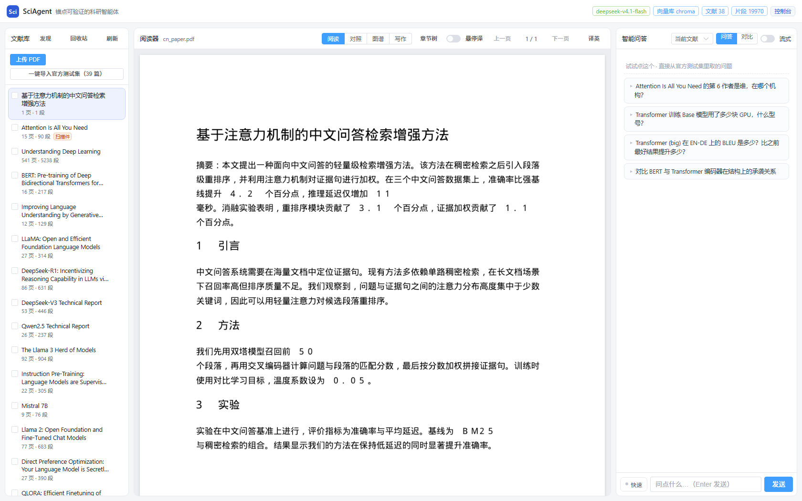
<figcaption><b>图 1</b>　主界面三栏布局：左侧文献库（39 篇），中间版式阅读器，右侧带证据的问答。</figcaption>
</figure>
<figure>
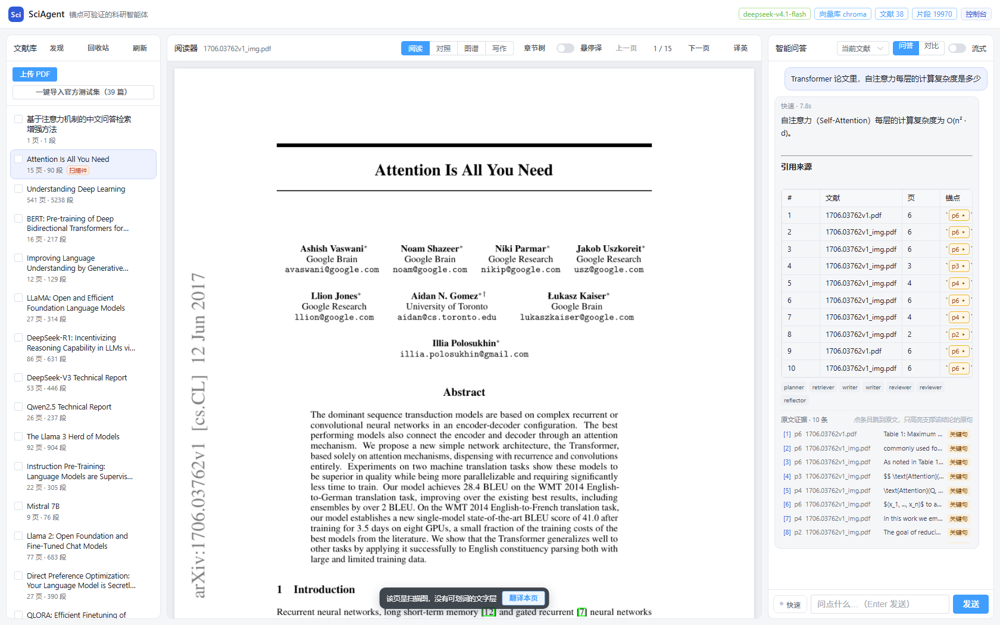
<figcaption><b>图 2</b>　表格型问题作答：结论 O(n²·d) 指向 Table 1 的 Complexity per Layer 行，右侧列出 5 条可点击证据。</figcaption>
</figure>
</div>

<div class="fig2">
<figure>
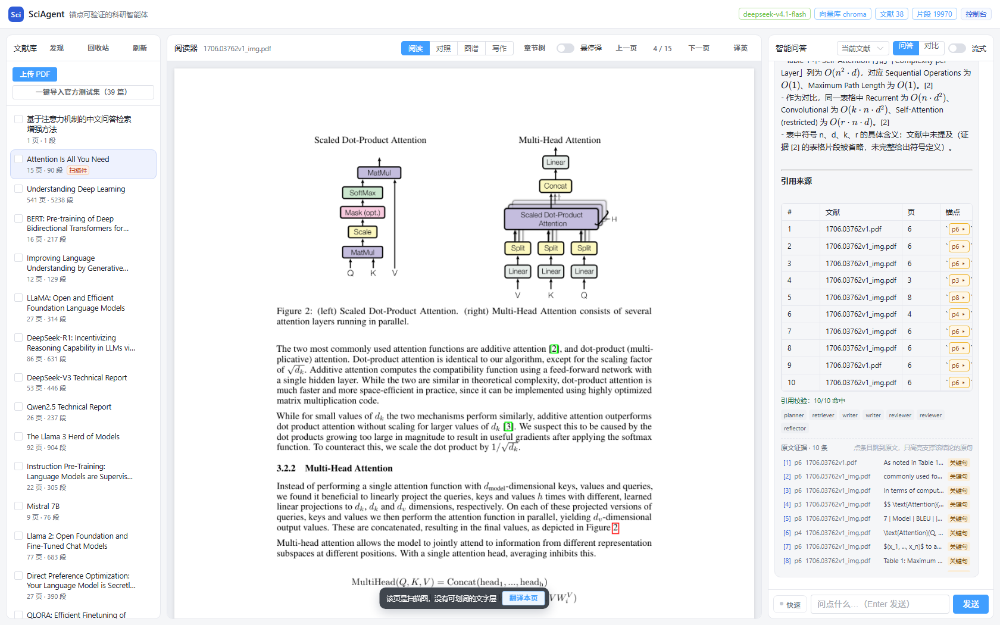
<figcaption><b>图 3</b>　版式阅读器：PDF 页图叠加可选文本层，公式经 KaTeX 渲染，章节树可跳转。</figcaption>
</figure>
<figure>
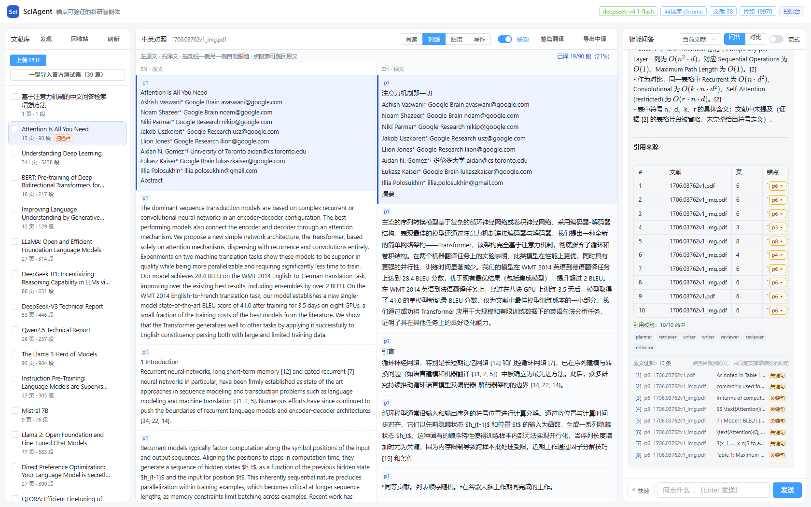
<figcaption><b>图 4</b>　中英对照：译文与原文段落一一对齐，滚动双向联动，译文缓存可下载。</figcaption>
</figure>
</div>

<div class="fig2">
<figure>
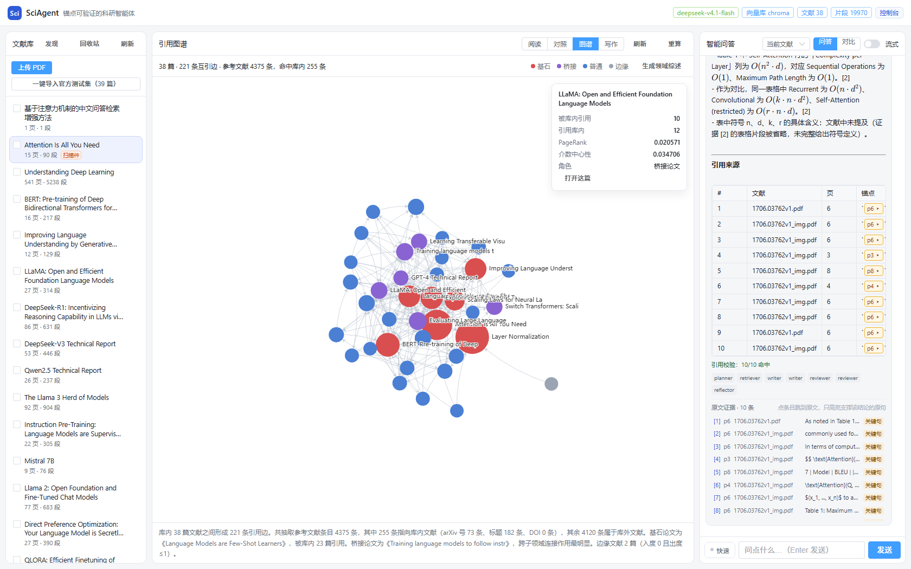
<figcaption><b>图 5</b>　引用图谱：39 篇 221 条互引边，按 PageRank 区分基石 / 桥接 / 普通 / 边缘，点击节点显示角色与被引次数。</figcaption>
</figure>
<figure>
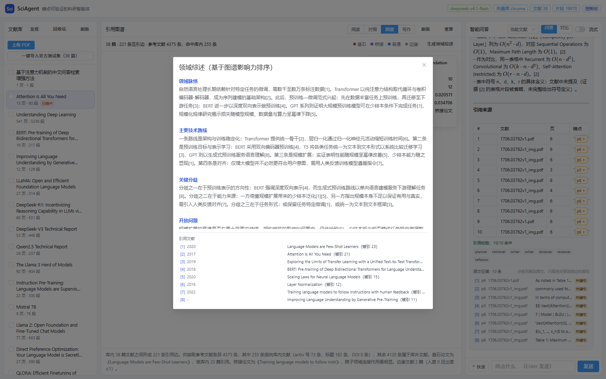
<figcaption><b>图 6</b>　领域综述：基于图谱影响力排序自动生成，列出的 8 篇均可点开原文。</figcaption>
</figure>
</div>

<div class="fig2">
<figure>
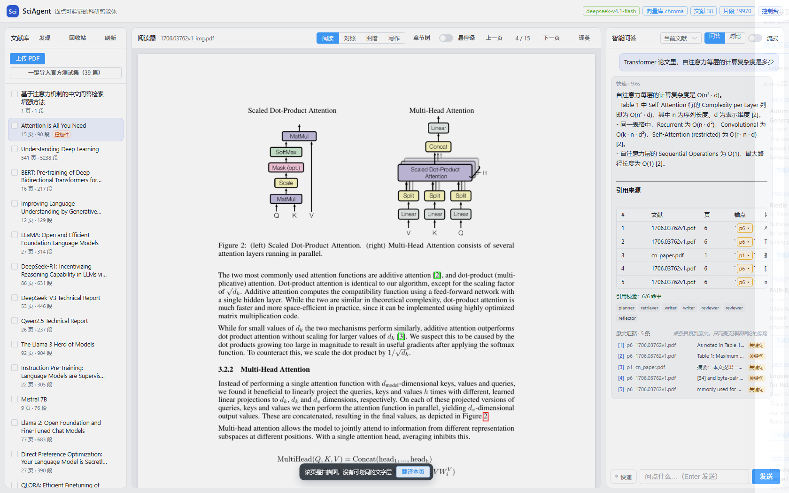
<figcaption><b>图 7</b>　论文发现：arXiv 检索与推荐，可按方向筛选并一键入库。</figcaption>
</figure>
<figure>
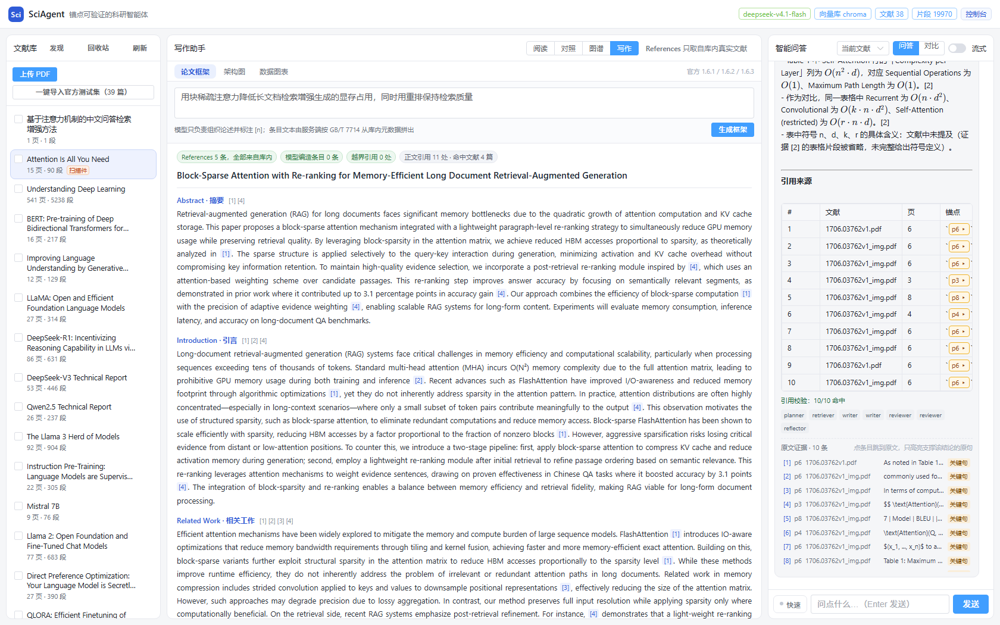
<figcaption><b>图 8</b>　写作助手：一句话想法生成论文框架，References 全部来自库内真实文献，正文 [n] 可跳回原文。</figcaption>
</figure>
</div>

<div class="fig2">
<figure>
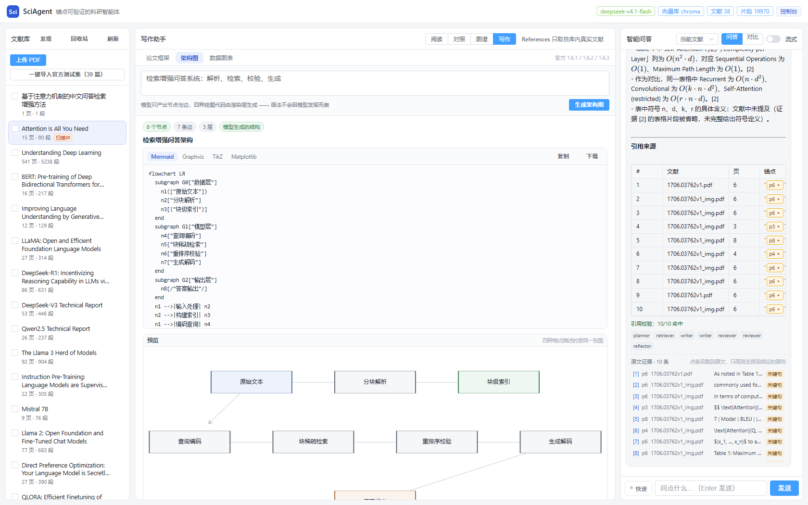
<figcaption><b>图 9</b>　架构图：一次生成 Mermaid / Graphviz / TikZ / Matplotlib 四种代码，预览与代码同构。</figcaption>
</figure>
<figure>
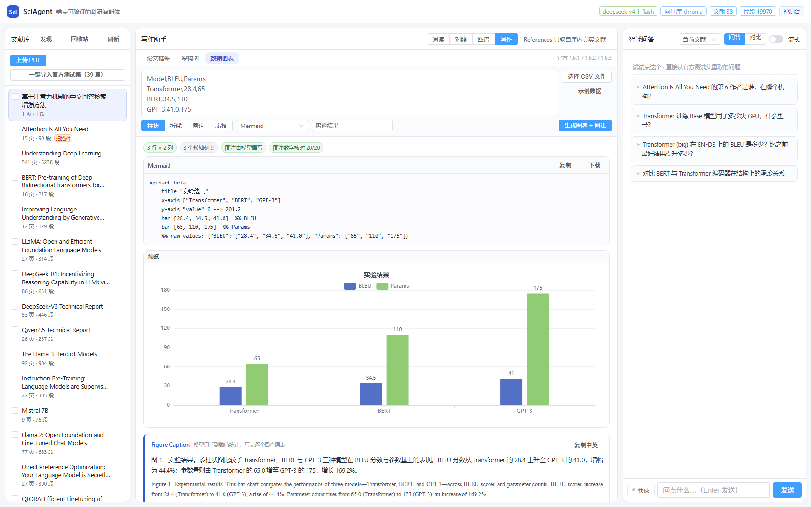
<figcaption><b>图 10</b>　数据图表与图注：图表代码可复制下载，图注数字逐个回查原表（20/20 通过才标绿）。</figcaption>
</figure>
</div>

<div class="fig2">
<figure>
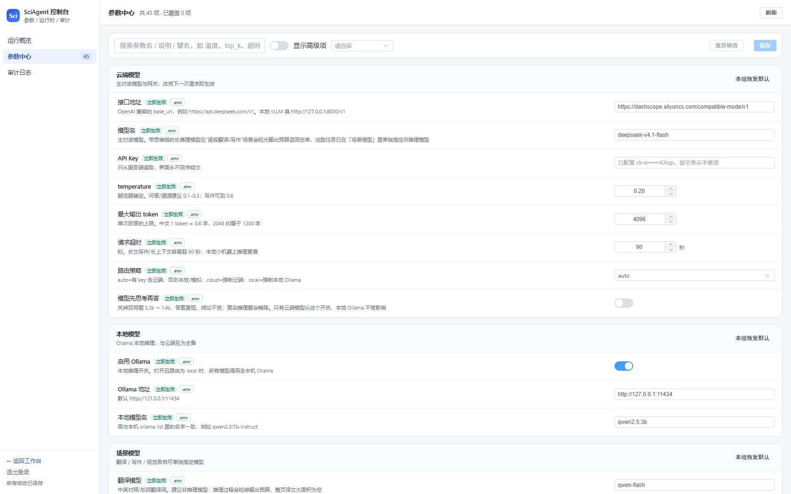
<figcaption><b>图 11</b>　参数中心：模型 / 检索 / 服务三类参数热生效，每项标注生效方式，改动进审计。</figcaption>
</figure>
<figure>
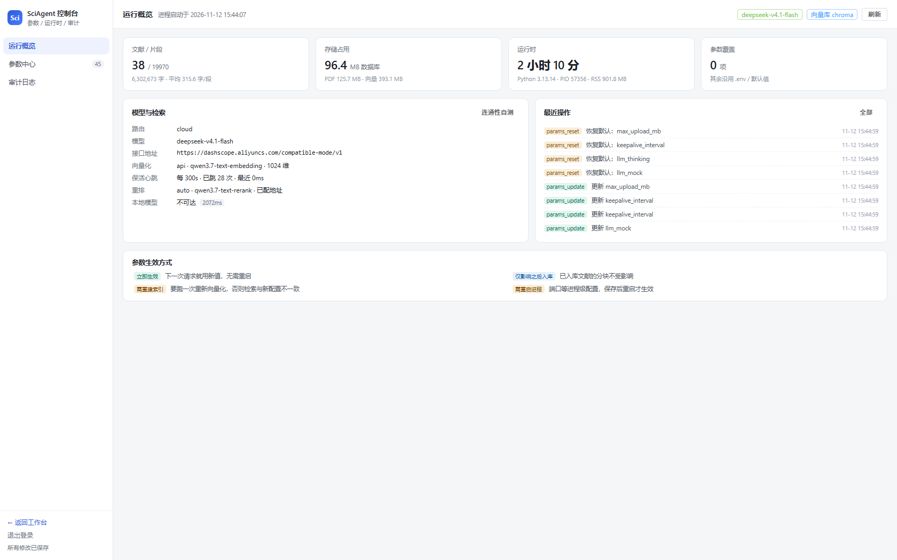
<figcaption><b>图 12</b>　运行时概览：语料规模、存储占用、模型与向量库状态、保活心跳。</figcaption>
</figure>
</div>

<div class="fig2">
<figure>
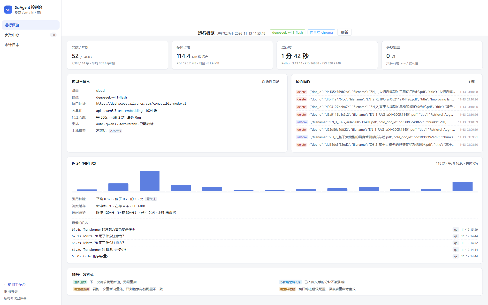
<figcaption><b>图 13</b>　运行时指标：缓存命中、检索耗时、降级次数等线上观测项，用于定位"变慢"发生在哪一层。</figcaption>
</figure>
</div>

# 6 项目之前是否发表过或获奖

**结论：本作品为首次参赛作品，此前未公开发表，未参加过其他赛事，暂无获奖记录。**

为避免歧义，把相关事实一次说清楚：

| 项 | 情况 |
| --- | --- |
| 期刊 / 会议论文发表 | 无 |
| 软著 / 专利 | 无 |
| 其他赛事获奖 | 无 |
| 是否已公开源码 | 是，GitHub 公开仓库（`LittlePrivateDetective/SciAgent`），含 109 次提交与 v1.0 / v1.1 / v1.2 三个 Release |
| 是否已有线上演示 | 是，`https://sciagent.zp-avatar.cn`（云端形态） |

**为什么把"没有"也写清楚**：作品介绍里最没信息量的写法是把"正在申请""有望获得"这类话当成绩写。这一项填"无"，其它项的实测数据才立得住。

# 7 若基于其他项目优化，请说明优化部分

**先说结论：本作品是独立实现的，没有 fork 或改造任何现有项目。** 但它在若干开源组件与标准算法之上构建，并对每一处做了针对本场景的改动。逐项说明如下。

## 7.1 建立在什么之上

| 基础 | 用途 | 标准做法 vs 本作品的改动 |
| --- | --- | --- |
| **PyMuPDF** | PDF 文本与坐标抽取 | 库只给 span / line / block 的裸数据。本作品在其上自建版面重建：双栏阅读顺序、裸数字块拼回编号、按点位数定层级、**按合并前的行坐标重建表格网格**（纵向重叠聚行、用全表空白切列）。这是"表格能不能答"的分水岭 |
| **混合检索 + RRF** | 向量与 BM25 融合 | 标准 RRF 是等权融合。本作品把重排候选从 16 条扩到 40 条（否则表格块排 55 名外永远见不到重排器）、给数值题保留专属表格位、补偿中文问英文表的 BM25 零分。实测数值题召回 6/6 |
| **BAAI/bge-m3** | 离线向量化 | 常规做法装 sentence-transformers 走 `encode()`。本作品直接用 transformers 前向 + CLS 池化，**省掉约 400 MB 依赖**，并把单条向量化做到 98 ms |
| **ChromaDB** | 向量库 | 默认后端。本作品在离线模式**主动分流到 SQLite BLOB + NumPy 暴力内积**：用约 80 MB 内存换掉 394 MB 索引体积，部署包从 630 MB 降到 520 MB 量级，且避免"两套向量混在同一个 collection 里悄悄答错" |
| **LangGraph** | Agent 编排 | 默认依赖。本作品实现**同一组节点的内置执行器**：LangGraph 装不上或不兼容时自动降级，节点与状态机不变，只在 `/health` 标记 `engine: builtin` |
| **Ollama** | 本地模型推理 | 默认参数会用上下文窗口当上限。本作品显式传 `num_predict=512` 并写进配置，把本地单次问答从 **76–102 秒压到 4.5–6.5 秒**；流式与非流式两条路径分别处理 |
| **Vue 3 + Element Plus** | 前端 | 常规引入 CDN。本项目把静态资源**全部本地化**（否则国内网络下首屏白屏），并去掉前端构建链，克隆即可运行 |
| **PageRank（networkx）** | 图谱角色划分 | 标准算法。本作品用**独立实现复算**做交叉校验，偏差 4.98e-07，确保"基石论文"不是库算错导致的 |

## 7.2 没有沿用而是重写的部分

| 部分 | 常见做法 | 本作品的做法与原因 |
| --- | --- | --- |
| 引用呈现 | 给页码或文献标题 | 给矩形坐标 `[p7@x0,y0,x1,y1]`，可画框、可回查、可校验。页码粒度不足以支撑"点回原文" |
| 抗幻觉 | 提示词里要求"不要编造" | 结构性约束 + 四道校验 + **校验器自身的误判率测量**。提示词约束在长上下文里会被稀释 |
| 图表 / 架构图 | 让模型直接写 TikZ / Mermaid | 模型产 JSON 结构，渲染层产代码（24 种输出）。模型的失败只影响内容，不产出编译不过的代码 |
| 参考文献 | 让模型写条目 | 模型只写编号，条目由服务端按 GB/T 7714 从库内元数据拼接，越界剔除 |
| 切块 | 按固定字数滑动窗口 | 按章节树与版面切分，表格/公式/参考文献各自成类，检索时可按类型配额 |
| 失败处理 | 报错或静默降级 | 五级降级且**降级必须可见**：每个降级点都在接口或界面上留痕 |

## 7.3 一句话总结

**站在开源组件之上，但每一个"能不能答对"的关键取舍，都是在本项目的语料上测出来的，不是照抄默认值。** 上面这些改动里有几处正好相反于直觉（例如离线主动放弃 Chroma、把小模型换成大模型、把候选从 16 扩到 40），每一处都能在技术文档里找到对应的前后对比数据。

# 附录 · 交付物清单

| 交付物 | 位置 |
| --- | --- |
| 源码仓库 | `github.com/LittlePrivateDetective/SciAgent`（109 次提交，3 个 Release） |
| 在线演示 | `https://sciagent.zp-avatar.cn` |
| 技术文档（30 页） | 仓库 `docs/技术文档.pdf`，含架构、七条链路、缺陷台账、性能与部署 |
| 本地部署说明 | 仓库 `docs/纯本地模式.md`、`README.md` |
| 测试证据 | 仓库 `docs/qa/`（缺陷台账、用例结果、证据 JSON） |
| 复现命令 | `pytest -q`（159 条单测）、`tests/qa_suite.py`（40 条功能用例） |
