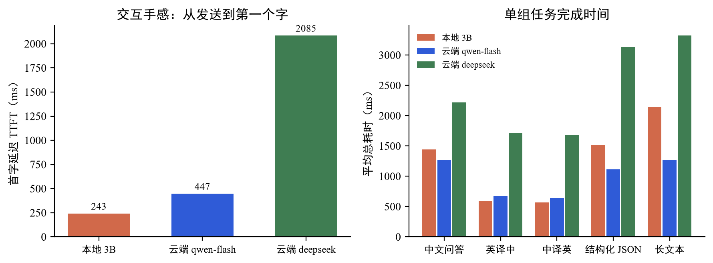
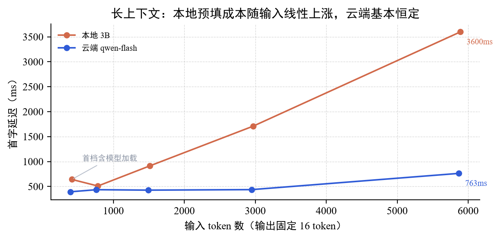
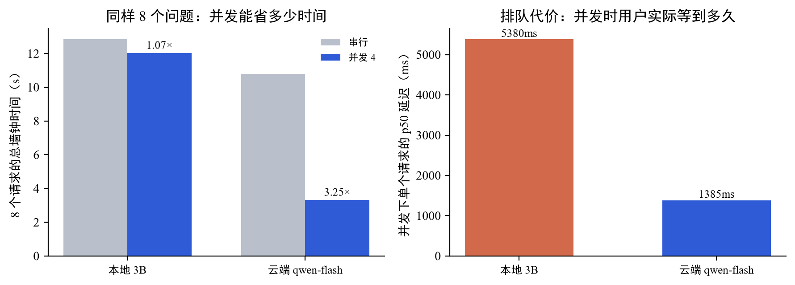
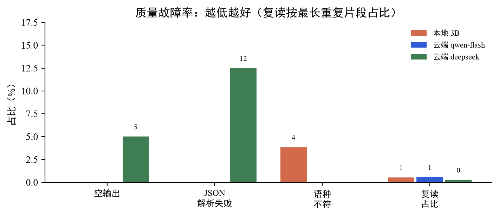

# 本地模型 vs 云端模型：实测对比

> 测试时间 2026-11-11 23:40–23:56 · 40 组固定题 × 3 个模型 · 单机 RTX 2060 6GB
> 原始数据：`./qa/evidence/local-model/bench_raw.json`、`prefill_raw.json`、`concurrency_raw.json`
> 测试脚本：`docs/local-bench/`（独立目录的归档副本，含 40 组题目与复现命令）
> 复现：`python bench.py --models local,cloud-fast,cloud-main`

## 一句话结论

**3B 本地模型在短文本任务上已经够用，首字延迟比云端快 4 倍；但长上下文和并发是它的硬边界——6k token 要等 3.6 秒，4 路并发完全没有加速。所以它不是"云端的替代品"，而是"短任务 + 隐私场景"的补充档。**

另有一条落地教训：把项目切到本地路由后，中译英一开始**直接失败**——根因不是模型，而是 825 字符的长指令让 3B 陷入复读；换成 87 字符的精简提示词后 0.5 秒正常。详见第六节。

## 测试条件

| 项 | 值 |
| --- | --- |
| 硬件 | RTX 2060 6GB（驱动 565.90）/ 16GB 内存 / Windows |
| 本地模型 | qwen2.5:3b，Q4_K_M 量化，1.93GB，Ollama 0.40.15 |
| 云端对照 | qwen-flash（项目里翻译/写作用的）、deepseek-v4.1-flash（主模型，带思维链） |
| 题量 | 40 组：中文问答 10 / 英译中 8 / 中译英 8 / 结构化 JSON 8 / 长文本 6 |
| 测量方式 | 流式调用，逐 chunk 记时间戳；TTFT = 第一个含内容的 chunk 到达时刻 |
| 显存采样 | 推理期间每 0.5s 采一次 nvidia-smi，共 318 个样本 |

题目全部取自项目真实用途（RAG 问答、学术翻译、图注与架构图 JSON、长文摘要），不是通用 benchmark。

## 一、快在哪，慢在哪



| 指标 | 本地 3B | 云端 qwen-flash | 云端 deepseek |
| --- | ---: | ---: | ---: |
| 首字延迟 p50 | **114 ms** | 431 ms | 1597 ms |
| 首字延迟 p90 | 822 ms | 513 ms | 2649 ms |
| 单组平均总耗时 | 1219 ms | **991 ms** | 2357 ms |
| 生成速度 | 65.9 tok/s | 157.3 tok/s | 611 tok/s（不可比） |
| 输出 token 合计 | 2234 | 3525 | 10171 |

**首字延迟本地赢了，而且赢得很干脆。** p50 只有 114ms，是 qwen-flash 的 1/4。原因很简单：没有网络往返、没有排队，请求直接进显卡。对话式交互里，"按下回车到看见第一个字"的体感差别就来自这 300 毫秒。

但**总耗时本地输了**。短输出还能打平（翻译类 593ms vs 673ms，本地甚至更快），长输出被甩开两倍多——65 tok/s 对 157 tok/s，字数一多就要还债。

一处要说明：deepseek 的 611 tok/s 是**假象**。它的思维链在首字之前就算完了（TTFT 1.6–2.6 秒里包含推理时间），之后吐最终答案很快，用"输出 token ÷ 首字后的时间"算出来自然虚高。**带思维链的模型，这个指标不能跟非 CoT 模型并列比较**。

## 二、长上下文是分水岭



40 组基准里的"总耗时"混了两件事：读输入（prefill）和写输出（decode）。不同题目答案长短差三倍，直接画"耗时 vs 输入长度"会得出反直觉的结论（初版图里本地斜率一度比云端还低）。所以单独做了一组：**输出锁死 16 token，只让输入变长**。

| 输入 token | 本地 TTFT | 云端 TTFT | 本地慢多少 |
| ---: | ---: | ---: | ---: |
| 414 | 642 ms* | 394 ms | 1.6× |
| 782 | 510 ms | 436 ms | 1.2× |
| 1511 | 912 ms | 427 ms | 2.1× |
| 2969 | 1709 ms | 438 ms | 3.9× |
| 5890 | 3600 ms | 763 ms | 4.7× |

\* 首档含模型加载（冷启动 5.4 秒），所以 414 token 反而比 782 token 慢。

本地约 **0.6 ms/token** 的预填成本，几乎是线性的；云端在 3k token 以内基本恒定在 430ms 左右（那是网络与调度开销，不是算力）。**转折点大约在 1500–2000 token**：RAG 一次塞 5 个段落（约 2500 token），本地就要等 1.7 秒才出第一个字，云端还是 0.4 秒。

这也解释了为什么项目里"整篇翻译"这种任务必须走云端：一篇论文 16k 字符分批后每批 1200 字，本地每批都要重新预填。

## 三、并发：本地真正的短板



8 个问题、4 路并发：

| | 本地 3B | 云端 qwen-flash |
| --- | ---: | ---: |
| 串行总耗时 | 12.84 s | 10.80 s |
| 4 路并发总耗时 | 12.03 s | **3.32 s** |
| 并发加速比 | **1.07×** | 3.25× |
| 并发下单请求 p50 | 5380 ms | 1385 ms |
| 总吞吐 | 62.3 tok/s | 341.6 tok/s |

**本地的加速比只有 1.07×，等于没有并发。** 一块 2060 的算力被第一个请求占满，后面三个排队；用户侧的体感是"本来 1.7 秒的回答，现在要等 5.4 秒"。

云端 3.25× 的加速来自横向扩容，这是本地部署换不来的——除非加卡。

对应到项目：**后台在翻译整篇论文（3 路并发）的同时，前台的划词翻译会明显变慢**。这是本地部署必须提前知道的。

## 四、质量：3B 够用，但有明确边界



| 指标 | 本地 3B | qwen-flash | deepseek |
| --- | ---: | ---: | ---: |
| 空输出 | 0/40 | 0/40 | **2/40** |
| JSON 可直接解析 | **8/8** | 8/8 | 7/8 |
| 语种符合要求 | 25/26 | **26/26** | 26/26 |
| 复读占比 | 0.5% | 0.6% | 0.3% |

三个值得说的发现：

**1. 结构化 JSON 上 3B 追平了云端。** 8 道题（图注、架构节点、术语表、三行大纲）全部可以直接 `json.loads`。原因是这类任务的输出格式由题目强约束，靠的不是模型规模。

**2. 本地唯一的质量失分是术语不译。** A02 问 BERT 的两个预训练任务，本地答：

> BERT 的预训练任务包括 masked language model 和 next sentence prediction。

句子通了，但两个术语原样留着英文——中文读者要自己翻译。云端会写成"掩码语言模型（MLM）和下一句预测（NSP）"。**这是 3B 和云端最典型的差距：不是不会答，是"用中文说话"这件事做得不够彻底。**

**3. 最强的模型反而最不稳。** deepseek 出现了 2 次空输出，都是因为思维链把 `max_tokens` 吃光了：

- D02（抽架构节点）：预算 1400 token，推理用完，答案区为空
- E05（200 字综述）：预算 1000 token，同样被推理吃光

这不是模型不行，是**配置问题**：CoT 模型的 `max_tokens` 必须按"答案长度 × 2 + 500"给，否则会得到一个"思考得很认真、什么都没说"的空回复。项目里 `LLM_MAX_TOKENS=4096` 就是踩过这个坑之后定的。

## 五、成本

40 组题的总成本：

| | 本地 3B | qwen-flash | deepseek |
| --- | ---: | ---: | ---: |
| 按公开价折算 | **0 元** | 0.0069 元 | 0.103 元 |

单看数字，40 组题才几分钱，云端并不贵。**本地部署的成本优势不在电费，而在"无限次调用不心疼"**——比如给 37 篇论文逐段生成摘要、给每篇生成架构图，这类批量任务用本地可以随便跑，用云端就要算账。

真正的成本项是硬件：一块能跑 3B 的 6GB 卡（二手 2060 约 800 元）和一块 24GB 卡（跑 7B–14B，约 6000 元）之间的差距，才决定"本地能到什么水平"。

## 六、在项目里真跑：一处必须修的适配

前面的数据都是脚本直接调 API 得到的。真正的验收是**把项目切到本地路由，走真实业务接口**。

在后台参数中心把 `llm_route` 改成 `local`，然后调 `/api/translate`：

| 用例 | 修复前 | 修复后 |
| --- | --- | --- |
| 短句英译中 | 0.52 s ✓ | 0.68 s ✓ |
| 中译英（学术句） | **9.15 s ✗ 返回"翻译服务暂时不可用"** | 0.52 s ✓ |
| 长句英译中（42 词） | **9.66 s ✗** | 0.84 s ✓ |
| 含公式句 | — | 0.57 s ✓ |

修复前那 9 秒是三次重试的总和。日志里的真实错误是：

```
WARNING | LLM 调用失败(第 1 次): Ollama HTTP 500:
        {"error":"prediction aborted, token repeat limit reached"}
```

排查过程：先怀疑采样参数，把 `repeat_penalty` 从 1.15 试到 1.3、`repeat_last_n` 加到 256、
`num_predict` 从 700 收到 300——**五种组合全部复现**。最后用同样的输入换提示词：

| system prompt | 结果 |
| --- | --- |
| 项目里的 `_SYS_EN`（825 字符、7 条规则） | 1.9 s ✗ 复读中止 |
| 换成 3 句话的短指令 | **0.3 s ✓ 正常出译文** |

结论很明确：**不是模型不行，是提示词没为它适配。** 3B 级模型扛不住 800 字符的多规则指令，
一进去就陷入重复循环；而云端模型完全没这个问题，所以这套提示词在云端一直"看起来是对的"。

改法：`_translate_batch` 按 `gateway.route()` 选提示词——云端用原来那版，本地用精简版
（`_SYS_LITE` / `_SYS_EN_LITE`，各 87 / 272 字符），核心约束保留：段数相等、术语统一、
公式与 `[n]` 角标原样、不留中文。

顺带修了一处笔误：`_SYS_EN` 里 `"Rules://n"` 本该是 `"Rules:\n"`，之前一直把字面量
`//n` 喂给模型。

**这条经验比跑分更值钱**：本地部署的成败有一半不在模型，在提示词是否为小模型重写过。

还有一个已知瑕疵没修：含 `\text{log}` 的公式句，本地模型输出经 JSON 解析后 `\t` 被当成制表符，
译文里出现 `L = -	ext{log}`。云端模型输出同样的内容时不会命中（它更倾向于把公式放在 `$...$` 里
原样返回）。这属于"本地模型 + LaTeX 转义"的边缘情况，已记入缺陷表。

## 七、这个项目该怎么用

基于上面的数据，给出分场景建议（项目里 `llm_route` 已支持 `auto / cloud / local`）：

| 功能 | 建议路由 | 理由 |
| --- | --- | --- |
| 划词翻译 / 悬停翻译 | **本地优先** | 输入 100–300 字符、输出 30–80 字，本地 TTFT 114ms 完胜；断网也能用 |
| 图注 / 架构图 JSON | **本地优先** | JSON 8/8 通过，短输入短输出；项目已有 `check_numbers` 与结构清洗兜底 |
| RAG 问答 | **云端优先** | 检索段约 2–3k token，本地首字要 1.5–2 秒，体感明显下降 |
| 整篇翻译 | **云端** | 长输入 + 3 路并发，本地两条都不占优（并发加速仅 1.07×） |
| 批量后台任务 | 本地可接受 | 慢但零成本，跑一晚上也无所谓 |

一句话：**本地模型适合"短、频、隐私敏感"的三类任务，不适合"长、并发、要质量"的三类任务。**

## 八、局限

1. **只测了 3B**。7B/14B 在 24GB 卡上的表现会明显不同（质量接近云端，速度约 40–50 tok/s），本机显存不够没测。
2. **没测量化损失**。Q4_K_M 是精度与体积的折中，Q8 或 FP16 的质量会更好、速度更慢，这组数据没有覆盖。
3. **单机单卡**。多卡、vLLM 批处理调度下的并发表现会完全不同，不能拿这份数据推断"本地一定扛不住并发"。
4. **质量判据是机械的**。JSON 可解析、语种占比、复读率能挡住硬伤，但"答得对不对"仍需要人工看——报告里的判断题结论（如 A02 术语未译）是逐条读出来的。
5. **一张图一条命**。40 组题的答案原文都在 `results/*.json` 里（每组前 600 字），有疑问可以直接翻，不必信这份报告的转述。
